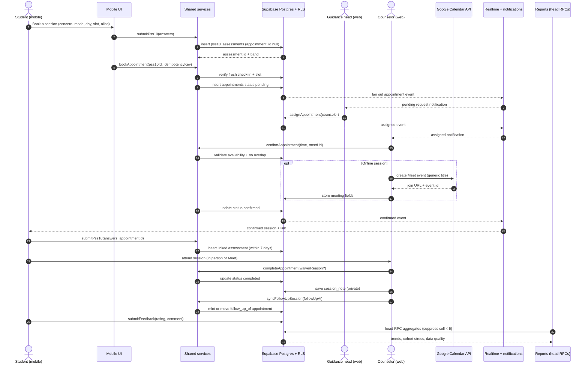
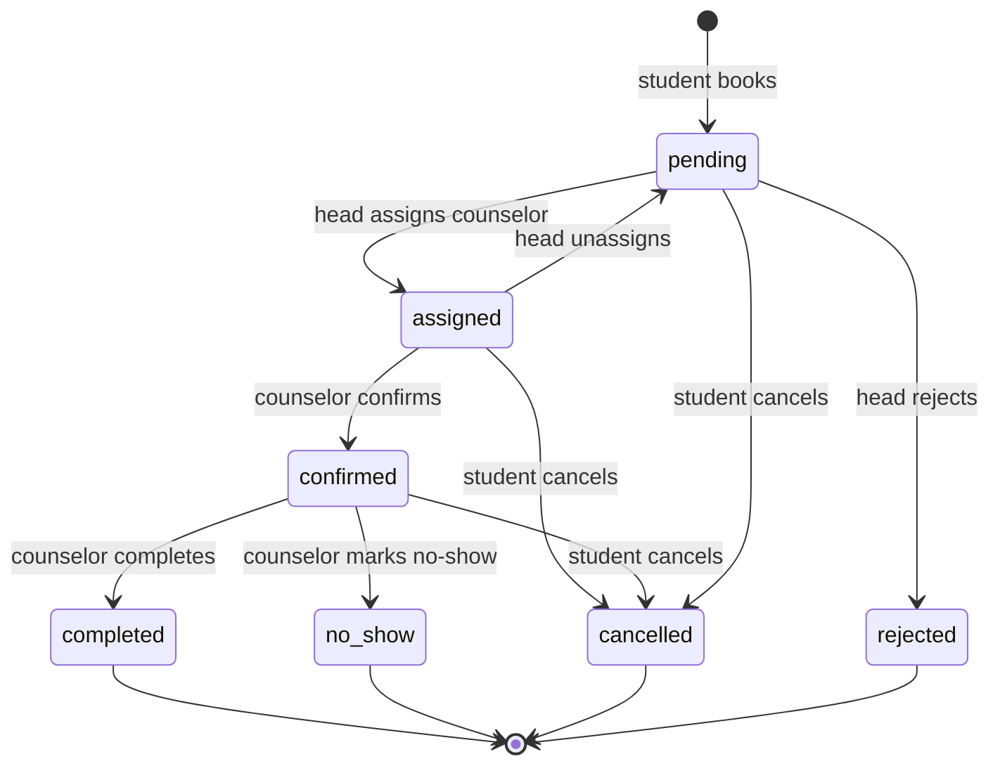

# Objective-Focus Workflow: Booking to Follow-Up

This document follows the flagship DCAS flow end to end: a student books, completes a stress check-in, is assigned and confirmed, attends an anonymous session, the counselor documents it, the office sees aggregate trends, and a follow-up is scheduled. It names the real rules, the real components, and the real tables so a tester can reproduce the flow and a reviewer can see where each promise is enforced.

**Audience:** testers, thesis panel, developers, and demo presenters.

**Scope:** the flow that carries Objectives 2, 3, 4, 5, 6, and 8. Referral-created sessions join the same lifecycle through `appointments.source_referral_id`.

---

## 1. The flow in plain language

A student opens the app, chooses a concern and a time, answers a ten-question stress check-in, and sends a request. The guidance head sees the request and chooses a counselor. The counselor confirms the time inside their availability; for an online session they add a Google Meet link. The student sees the confirmed session and can chat with that counselor. Shortly before the session the student completes a fresh pre-session check-in. After the session the counselor marks it complete and writes a private note, optionally scheduling a follow-up. The office analytics then count the session in aggregate, with small groups suppressed. The student's identity stays behind an alias throughout; only a logged break-glass action can reveal it.

---

## 2. Step-by-step system behavior

| # | Step | Who | What the system does | Where the rule lives |
|---:|---|---|---|---|
| 1 | Choose a concern, mode, day, and slot | Student | Reads `counselor_availability`, computes bookable days and slots for the next seven days. | `apps/mobile/app/book.tsx`; `packages/shared-services/src/appointments/availability.ts` |
| 2 | Complete the booking check-in | Student | Scores ten answers, writes `pss10_assessments` with `appointment_id = null`, and returns the assessment id. | `submitPss10` in `appointments/mutations.ts`; `assessments/pss10-scoring.ts` |
| 3 | Create the request | Student | Verifies a check-in exists and is no more than 30 days old, checks the slot when a counselor was chosen, then inserts an appointment with status `pending` and an idempotency key. | `bookAppointment` in `appointments/booking-service.ts`; `createAppointmentSchema` |
| 4 | Fan out the request | Database | A trigger notifies the guidance head; the board receives a realtime event. Payloads carry IDs and status, not student identity or clinical content. | `supabase/migrations/00043_appointment_update_fanout.sql`, `00065_session_reminders.sql`; `docs/realtime-audit.md` |
| 5 | Assign a counselor | Guidance head | Writes `counselor_id` and status `assigned` from `pending` or `assigned`. | `assignAppointment`; `/appointments`; `rbac.ts` |
| 6 | Confirm the session | Counselor | Requires status `assigned`; validates the time inside the counselor's availability and against other sessions; for online mode requires a `meet.google.com` URL; writes `confirmed` and `confirmed_datetime`. | `confirmAppointment`; `validateCounselorSchedule`; migration `00059` exclusion constraint |
| 7 | Add a Meet link (online only) | Counselor | Creates a Google Calendar event with a generic title and stores `meeting_url`, `meeting_provider`, `meeting_event_id`, `meeting_created_at`. Pasted links are stored as provider `manual`. | `/api/appointments/meet`; `appointments/meeting.ts`; migration `00072` |
| 8 | See the confirmed session | Student | Reads the appointment with the counselor, schedule, and link; realtime patches the session list. | `apps/mobile/app/(tabs)/sessions.tsx`; `listStudentAppointments` |
| 9 | Open a chat thread | Student | Lists only counselors from the student's confirmed or completed sessions; reuses one thread per student-counselor pair. | `chat-service.ts`; migrations `00011`, `00012`, `00074` |
| 10 | Pre-session check-in | Student | Opens seven days before the start, closes at the start plus a five-minute clock tolerance; writes an assessment linked to the appointment. | `submitPss10` pre-session branch; `pre-session-pss10.ts` |
| 11 | Attend the session | Student + counselor | In person or through the Meet link. No additional state is written for attendance; the outcome is recorded next. | `appointments.mode`, `meeting_url` |
| 12 | Complete or mark no-show | Counselor | Completion requires `confirmed`; requires a linked check-in submitted within the seven-day window, or a 10-500 character waiver that is written to `pss10_waived_at` and `audit_logs`. No-show requires `confirmed`. | `completeAppointment`, `markAppointmentNoShow`; migration `00068` |
| 13 | Write the session note | Counselor | Only on a completed session, only by the assigned counselor, one note per session. Freeform or S.O.A.P.; up to five private images; optional follow-up moment. | `/api/session-notes`; `sessionNoteSchema`; migrations `00009`, `00052`, `00053`, `00070` |
| 14 | Schedule a follow-up | Counselor | Validates the follow-up inside availability, then mints or moves a confirmed appointment linked through `follow_up_of`. | `validateFollowUpMoment`, `syncFollowUpSession`; migration `00054` |
| 15 | Rate the session | Student | Accepts one rating from 1 to 5 and an optional comment for that completed appointment. | `submitFeedback`; `feedbackSchema` |
| 16 | Aggregate the data | Guidance head | Head-only RPCs read appointments, referrals, check-ins, and feedback; cells smaller than five are suppressed before display and export. | `00061`, `00071`; `analytics/suppression.ts`; `/api/reports/head` |
| 17 | Follow up | Counselor + student | The follow-up appointment re-enters the same lifecycle at step 5 or 6, with the same alias and privacy rules. | `follow_up_of`; `/sessions` |

### Rules that are enforced more than once

The point of defense in depth is that a UI shortcut cannot skip a rule:

| Rule | UI | Shared service | Database |
|---|---|---|---|
| Future-only booking | Disabled past slots | `bookAppointment` throws | `scheduled_at` check + slot constraint |
| No double booking | Slot picker | Slot gate before insert | `no_counselor_overlap` exclusion constraint (`00059`, `00067`) |
| Check-in before booking | Booking flow | 30-day freshness gate | `pss10_id` reference |
| Check-in before completion | Completion dialog | `getValidPreSessionPss10` | `pss10_waived_at` / waiver constraint |
| Meet link for online | Confirm dialog | `confirmAppointment` | Provider and URL columns |
| Alias-only routine work | Boards render aliases | Scoped queries | RLS `00069` |
| Note privacy | Counselor-only editor | API ownership checks | RLS `00052`, private storage bucket |
| Append-only audit | Read-only console | Audit writes in the service/route | Triggers and no update/delete policies |

---

## 3. Sequence diagram

### Reading the diagram

- The two check-ins are different records. The **booking** check-in is a gate for creating the request; the **pre-session** check-in is linked to the appointment and is the one completion checks.
- The head assigns; the counselor confirms. Neither action is a general-purpose status edit.
- The Google Meet call happens inside the confirmation path. If it fails, the manual paste fallback keeps the session confirmable.

---

## 4. Appointment lifecycle

Allowed transitions and guards:

| From | To | Actor | Guard |
|---|---|---|---|
| `pending` | `assigned` | Guidance head | Counselor exists and is active |
| `pending` | `rejected` | Guidance head | Only pending; unassign first if assigned |
| `assigned` | `pending` | Guidance head | Clears counselor |
| `assigned` | `confirmed` | Counselor | Time is future, inside availability, no overlap; online needs a Meet URL |
| `pending` / `assigned` / `confirmed` | `cancelled` | Student | Never from a terminal status |
| `confirmed` | `completed` | Counselor | Fresh linked check-in or audited waiver |
| `confirmed` | `no_show` | Counselor | Only confirmed |
| `completed` / `no_show` / `cancelled` / `rejected` | - | - | Terminal |

The database check constraint in `00029` also constrains the status set, so an unknown status cannot be written.

---

## 5. Worked example with fictional data

> All names, numbers, times, and scores below are invented for illustration. They are not real student records.

**Cast:** Student "Client-4821" (alias), Counselor "C. Reyes", Guidance head "H. Lim".

1. **Monday, 09:10.** Client-4821 opens the app, chooses "Academic stress", **In person**, Thursday 14:00, and turns on **Book under my alias**. They answer the check-in. The score is 19, band **moderate**. The request is created as `pending` and the app opens Chat.
2. **Monday, 09:15.** H. Lim sees the pending request on the dashboard and assigns C. Reyes. The status becomes `assigned`.
3. **Monday, 10:02.** C. Reyes opens the request. Thursday 14:00 is inside their availability and does not overlap. They confirm. The student sees **Confirmed** and the room/time.
4. **Wednesday, 16:30.** Client-4821 opens **Pre-session check-in** from the confirmed session, answers again, and the new assessment is linked to the appointment. The state becomes `complete`.
5. **Thursday, 14:00.** The session happens in person. C. Reyes marks it **Completed**. Because a fresh linked check-in exists, no waiver is needed.
6. **Thursday, 14:50.** C. Reyes writes a S.O.A.P. note, attaches no images, and sets a follow-up for two weeks at 15:00. The follow-up appointment is minted as `confirmed` and linked through `follow_up_of`.
7. **Thursday, 15:05.** Client-4821 rates the session 5 with the comment "Felt heard." The rating appears in the feedback page and in aggregate reports.
8. **Friday, 08:00.** H. Lim opens Reports, groups by year level, and exports the workbook. One year level has four students, so that cell is suppressed rather than shown as a small count.
9. **Two weeks later.** The follow-up re-enters the lifecycle. The alias remains the same; the real identity is still sealed unless a break-glass event occurs.

### What a reviewer should verify in the example

- The booking check-in (step 1) and the pre-session check-in (step 4) are separate rows.
- Completion in step 5 is allowed because of step 4, not because of step 1.
- The follow-up in step 6 is a real appointment, not a note field.
- The suppressed cell in step 8 is not an error; it is the privacy threshold.

---

## 6. Failure modes and recovery

| Failure | How it shows up | What the system does | Recovery |
|---|---|---|---|
| Double booking | "That time was just taken" | The exclusion constraint rejects the second confirmed/assigned window; the service maps the error to a friendly message. | Pick another slot. |
| Missed booking check-in | "Complete a PSS-10 check-in before booking" | `bookAppointment` refuses to create the request. | Complete the check-in, then book. |
| Expired check-in at completion | Completion dialog offers a waiver | `PreSessionPss10RequiredError` carries a stable code; the UI asks for a 10-500 character operational reason. | Student checks in, or counselor records the waiver; the waiver is audited. |
| No-show | Counselor records **No-show** | Only a confirmed session can become `no_show`; terminal. | The student can book again. |
| Alias mismatch | The counselor cannot find the student in the emergency picker | The emergency picker is alias-only and caseload-scoped; the reveal route re-checks caseload and student linkage. | Log a new grant for the correct student if the relationship exists. |
| Expired break-glass | Reveal returns an authorization error | The grant is checked for expiry at reveal time; a new log is required. | Log a new grant and have the head review it. |
| Meet link creation fails | "Couldn't create a Meet link - paste one instead" | The route returns 503 when Google is disabled or the token fails; the client falls back. | Paste a `meet.google.com` link; the session can still be confirmed. |
| Google event orphaned | The session keeps a link that no longer exists | Student cancellation does not call Google cleanup; staff can **Remove link** on the session. | Remove or recreate the link. |
| Check-in submitted too early | "Pre-session check-in is only accepted within 7 days before the session starts" | The service checks the window relative to the session start. | Wait until seven days before, then submit. |
| Analytics under threshold | A blank cell or missing bar | `MIN_CELL = 5` suppression runs before display and export. | Read the data-quality panel; do not lower the threshold for a demo. |
| Note saved without follow-up | The note succeeds, the follow-up fails | The route returns `followUpError` but keeps the note saved. | Fix the follow-up time inside availability and save the note again. |
| Duplicate booking retry | Two identical requests | The idempotency key returns the existing row instead of a second insert. | Refresh; do not create a new key for the same intent. |
| Realtime disconnect | Chat or board looks stale | The provider reconnects and refetches the affected rows; no polling loop. | Wait for reconnect or reload the page. |

---

## 7. Code map

| Layer | File | Responsibility |
|---|---|---|
| Mobile booking step 1 | `apps/mobile/app/book.tsx` | Concern, mode, day, slot, alias toggle |
| Mobile booking step 2 | `apps/mobile/app/check-in.tsx` | PSS-10 submission and booking creation |
| Mobile sessions | `apps/mobile/app/(tabs)/sessions.tsx` | Status lists, reschedule, cancel, rate, pre-session check-in |
| Mobile chat | `apps/mobile/app/chat.tsx` | Threads and messages |
| Web appointment board | `apps/web/app/(staff)/appointments/page.tsx` | Assign, confirm, reschedule, complete, no-show, waiver, Meet link |
| Web session calendar | `apps/web/app/(staff)/sessions/page.tsx` | Calendar views and session actions |
| Web notes | `apps/web/app/api/session-notes/route.ts` | Note read/write, completed-only, follow-up sync |
| Web attachments | `apps/web/app/api/session-notes/attachments/route.ts` | Private images, ownership checks, caps |
| Web Meet | `apps/web/app/api/appointments/meet/route.ts` | Create, patch, delete Google Calendar events |
| Web reports | `apps/web/app/api/reports/head/route.ts` | Head aggregates and suppression |
| Booking rules | `packages/shared-services/src/appointments/booking-service.ts` | PSS-10 freshness, slot gate, idempotency |
| Lifecycle rules | `packages/shared-services/src/appointments/mutations.ts` | Guarded status changes |
| Pre-session rules | `packages/shared-services/src/appointments/pre-session-pss10.ts` | Seven-day window, reschedule cutoff, waiver state |
| Scoring | `packages/shared-services/src/assessments/pss10-scoring.ts` | Reverse scoring and bands |
| Availability | `packages/shared-services/src/appointments/availability.ts` | Bookable days and slots |
| Analytics | `packages/shared-services/src/analytics/suppression.ts` | Small-cell suppression |
| Schema | `supabase/migrations/00007`, `00008`, `00009`, `00059`, `00068`, `00070`, `00072` | Appointment, assessment, note, slot, gate, record, Meet |
| Tests | `appointments/*.test.ts`, `assessments/*.test.ts` | Booking, scoring, pre-session, meeting, idempotency |

---

## 8. Verification checklist

Run this against a staging project with seeded data. Do not use production records.

### Booking and check-in

- [ ] A booking creates a `pending` appointment with the chosen mode, concern, and alias setting.
- [ ] Booking without a recent check-in is refused with a clear message.
- [ ] Submitting the same idempotency key twice creates one appointment.
- [ ] Two simultaneous confirms for the same slot produce one winner and one "time was just taken" error.
- [ ] The booking check-in row has no `appointment_id`; the pre-session row does.

### Confirmation

- [ ] A counselor cannot confirm a `pending` request.
- [ ] A counselor cannot confirm outside their availability.
- [ ] An online confirmation without a Meet link is refused.
- [ ] A pasted non-Google URL is refused.
- [ ] A disabled Google integration returns 503 and the manual paste path still works.

### Session and notes

- [ ] Completion without a fresh linked check-in opens the waiver path.
- [ ] A waiver shorter than 10 characters is refused; a valid waiver is written and audited.
- [ ] A note cannot be created before completion.
- [ ] A second note for the same session is refused with the existing note id.
- [ ] Another counselor cannot read the note.
- [ ] The guidance head can read but cannot author the note.
- [ ] Six images are refused; a non-image file is refused.
- [ ] A failed follow-up does not delete the saved note.

### Privacy and analytics

- [ ] Boards show the alias, not the student's name.
- [ ] The student directory does not expose student numbers.
- [ ] A reveal without a grant fails.
- [ ] A counselor reveal before head review fails.
- [ ] A reveal after expiry fails.
- [ ] A successful reveal writes an audit row without clinical content.
- [ ] A report cell below five is suppressed in both the page and the Excel export.
- [ ] Notifications never contain check-in answers, scores, note text, or chat bodies.

### Realtime and recovery

- [ ] A new chat message appears for both sides without refreshing.
- [ ] Reconnecting after a dropped connection refetches the affected board.
- [ ] Notification dedupe prevents a duplicate inbox row on replay.

If any item fails, do not mark the related objective as Implemented in the defense until the behaviour and the document are corrected together.
