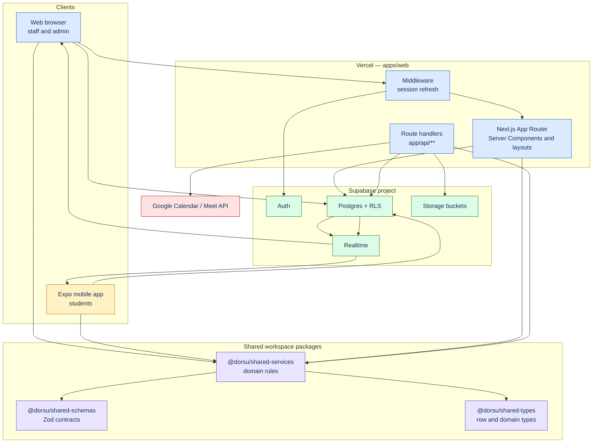

# Architecture

This document explains how DCAS is assembled: the two clients, the shared domain packages, the Supabase backend, and the request paths that connect them. It is the technical map behind the objective and sitemap documents, and it records the boundaries a contributor must not cross. Every statement below points to the file or migration that enforces it.

**Audience:** developers, maintainers, and technical reviewers.

---

## 1. System shape

DCAS is a pnpm/Turborepo monorepo with two clients and one backend:

| Layer | Package | Responsibility |
|---|---|---|
| Staff/admin web | `apps/web` | Next.js 14 App Router portal for counselors, guidance head, faculty, and admin, plus public auth pages. |
| Student mobile | `apps/mobile` | Expo SDK 58 / expo-router app for students. |
| Domain logic | `packages/shared-services` | Framework-free booking, PSS-10, referrals, chat, notifications, security, analytics, RBAC. |
| Input contracts | `packages/shared-schemas` | Zod schemas shared by both clients. |
| Types | `packages/shared-types` | `database.ts` row types and domain types. |
| Supabase access | `packages/supabase-client` | One URL/key resolution path for web and mobile. |
| Design tokens | `packages/ui-tokens` | Brand palette, typography, spacing for web; mobile mirrors in `theme.ts`. |
| Database mirror | `packages/db` | Prisma dictionary schema and trusted-script client; not the runtime data path. |
| Backend | Supabase project | Postgres, Auth, Storage, Realtime, Row Level Security. |
| Schema source | `supabase/migrations` | 74 ordered SQL migrations (`00000`–`00074`; `00055` absent). |

The runtime data path is **Supabase clients + RLS**, not Prisma. Prisma is a dictionary mirror used for validation and trusted scripts (`packages/db/prisma/schema.prisma:1-24`).

## 2. Runtime topology

Two details matter for security reviews:

1. The web server renders with a **cookie-bound Supabase SSR client**, so RLS sees the signed-in user (`apps/web/lib/supabase/server.ts`).
2. The **service-role client** (`apps/web/lib/supabase/admin.ts`) exists only in route handlers and bypasses RLS; every handler must re-check role and ownership in code (`AGENTS.md:150`).

## 3. Web application structure

Next.js route groups do not create URL segments (`AGENTS.md:155`):

| Group | URL examples | Guard |
|---|---|---|
| `app/(public)` | `/login`, `/register`, `/reset-password`, `/update-password` | No session required. |
| `app/(staff)` | `/dashboard`, `/appointments`, `/sessions`, `/chat`, `/referrals`, `/reports`, `/students`, `/emergency`, `/settings` | `requireRole(["counselor","guidance_head","faculty","admin"])` in the layout, then page-level checks. |
| `app/(admin)` | `/users`, `/users/new`, `/security`, `/security/events`, `/backups` | `requireRole(["guidance_head"])` in the layout. |
| `app/api` | 20 route handlers | Each handler authenticates and authorizes its own caller. |

The shared shell (`components/shared/staff-shell.tsx`, `staff-nav.tsx`) hides links a role cannot open, but hidden links are not the security boundary — `rbac.ts` and page guards are.

### Write paths

- Ordinary web writes: browser Supabase client + a function from `@dorsu/shared-services` (`AGENTS.md:153`).
- Privileged writes: `app/api/**` with a role re-check; examples include registration, notifications, break-glass logging/reveal, session-note file access, user status, and backups.
- There are **no Server Actions**; adding a second write style is discouraged (`AGENTS.md:153`).

### Read paths

Per-domain React Query hooks in `apps/web/lib/hooks/use-*-board.ts` own pagination, `keepPreviousData`, and incremental `patchBoard`. Realtime events patch the same cache through `components/shared/realtime-provider.tsx`; there are no polling loops (`AGENTS.md:152`).

## 4. Mobile application structure

`apps/mobile/app` is a flat expo-router tree (`apps/mobile/README.md:46-63`):

| Route | Purpose |
|---|---|
| `/` | Launch gate and first-install onboarding. |
| `/login`, `/register` | Supabase email/password and Google sign-in. |
| `/(tabs)/home` | Next session, announcements, quick actions. |
| `/(tabs)/sessions` | Upcoming, past, canceled; details, reschedule, cancel, rating. |
| `/(tabs)/profile` | Profile, avatar, onboarding replay, logout. |
| `/book` | Booking step 1: concern, mode, slot, anonymous toggle. |
| `/check-in` | Booking step 2: PSS-10, then appointment creation. |
| `/chat` | Counselor inbox and conversation. |
| `/notifications` | Notification inbox. |

Mobile uses the same shared services as web; screens do not contain booking or referral rules (`apps/mobile/README.md:87-88`). Session persistence uses an AsyncStorage adapter (`apps/mobile/lib/supabase/client.ts`).

## 5. Domain modules

| Module | Location | What it owns |
|---|---|---|
| Appointments | `packages/shared-services/src/appointments/` | Availability, booking, reschedule, cancel, confirm, complete, PSS-10 gate, Meet validation. |
| PSS-10 | `packages/shared-services/src/assessments/` | Instrument wording, scoring, bands. |
| Referrals | `packages/shared-services/src/referrals/` | Create, assign, confirm, resolve, escalate. |
| Chat | `packages/shared-services/src/chat/` | Threads, messages, staff messages. |
| Notifications | `packages/shared-services/src/notifications/` | Notification creation and push ledger contract. |
| Security | `packages/shared-services/src/security/` | Break-glass grant/reveal rules. |
| Analytics | `packages/shared-services/src/analytics/` | Suppression (`MIN_CELL = 5`) and aggregation helpers. |
| RBAC | `packages/shared-services/src/rbac.ts` | Route/action policy and home route. |

Domain services accept a `DbClient` and optional platform adapters; they never touch `window`, `localStorage`, `AsyncStorage`, or React (`AGENTS.md:145`).

## 6. Data flow examples

### Booking and confirmation

1. Mobile reads `counselor_availability` and calls `bookAppointment` with an idempotency key.
2. `appointments` is inserted as `pending`; the PSS-10 row is written by `submitPss10`.
3. Head assigns a counselor (`assigned`), then the counselor confirms inside availability (`confirmed`). Online confirmation requires a `meet.google.com` URL.
4. Postgres triggers fan out notifications and realtime events; the student sees the counselor and schedule.

The full sequence is documented in [objective-focus-workflow.md](../objectives/objective-focus-workflow.md).

### Analytics

Head-only RPCs (`head_wellbeing_trends`, `head_cohort_stress`, `head_data_quality`, `head_report_digest`) read aggregates. Cells below five are suppressed before display or export (`packages/shared-services/src/analytics/suppression.ts`). Excel export is built in `apps/web/lib/reports/`.

## 7. Deployment

| Target | Mechanism | Notes |
|---|---|---|
| Web | Vercel, `pnpm --filter @dorsu/web build` | `vercel.json` declares cron routes. |
| Database | Supabase remote project | Migrations applied manually/in order; `00055` is absent. |
| Mobile | Expo/EAS (`apps/mobile/eas.json`) | Android/iOS builds. |
| Cron | Vercel cron → `/api/admin/backups/cron`, `/api/reports/digest/cron` | Both require `CRON_SECRET`; return 503 when unset. |

## 8. Environment variables

Names only; no values belong in this repository.

| Variable | Consumer |
|---|---|
| `NEXT_PUBLIC_SUPABASE_URL`, `NEXT_PUBLIC_SUPABASE_ANON_KEY` | Web browser and SSR. |
| `EXPO_PUBLIC_SUPABASE_URL`, `EXPO_PUBLIC_SUPABASE_ANON_KEY` | Mobile. |
| `SUPABASE_SERVICE_ROLE_KEY` | Server-only route handlers. |
| `CRON_SECRET` | Backup and digest cron routes. |
| `GOOGLE_MEET_ENABLED`, `GOOGLE_CLIENT_ID`, `GOOGLE_CLIENT_SECRET`, `GOOGLE_REFRESH_TOKEN`, `GOOGLE_CALENDAR_ID` | Meet creation route. |
| `DATABASE_URL`, `DIRECT_URL` | Prisma validation/trusted scripts. |
| `TEST_SUPABASE_*`, `E2E_*`, `PERF_*` | Test and performance harnesses. |

No `.env.example` exists in this checkout, although several documents reference one. Treat that as a documentation gap, not a configuration source.

## 9. Verification and testing

| Layer | Command | Location |
|---|---|---|
| Typecheck | `pnpm --filter @dorsu/web typecheck`, `pnpm --filter @dorsu/mobile typecheck` | `apps/*` |
| Unit | `pnpm --filter @dorsu/shared-services test` | 9 files, 86 Vitest cases. |
| RLS integration | `pnpm --filter @dorsu/rls-tests test:rls` (see README) | `tests/rls/` |
| Browser journeys | `pnpm e2e` | `e2e/specs/{student,counselor,faculty,head}.spec.ts` |
| Performance | `npm run measure:*` in `perf-tests/` | Standalone harness. |
| CI | `.github/workflows/ci.yml` | Typecheck, unit, build, RLS, browser smoke. |

## 10. Known architectural limits

- Students have **no web portal**; the web shell rejects the student role.
- `packages/db/prisma/schema.prisma` does not mirror every table (for example `audit_events`, `staff_messages`, `backup_runs`); migrations remain authoritative.
- Session-note bodies are stored as plain text columns; there is no field-level encryption layer (see [security-privacy.md](../security/security-privacy.md)).
- The push-delivery worker is documented as a contract (`notification-service.ts`) but is not present in this repository.
- `rbac.ts` still lists `/analytics`, `/resources`, and `/appointments/new` even though no pages exist for them; see [ui-sitemap.md](../ux/ui-sitemap.md).
