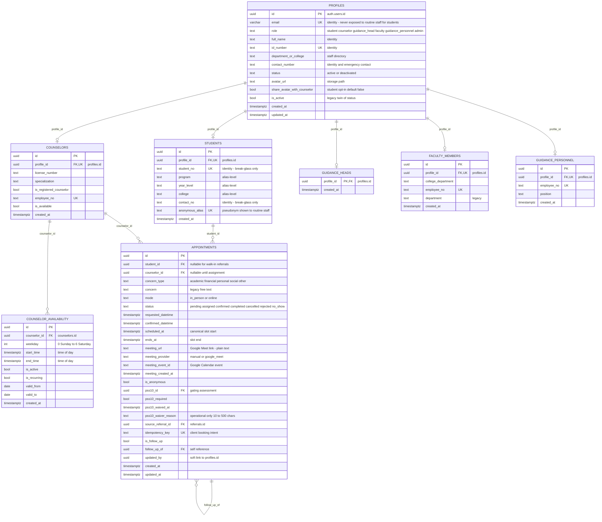
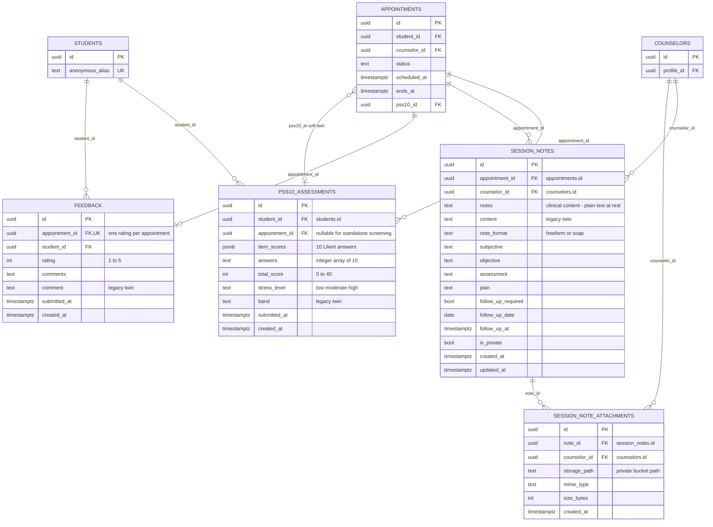
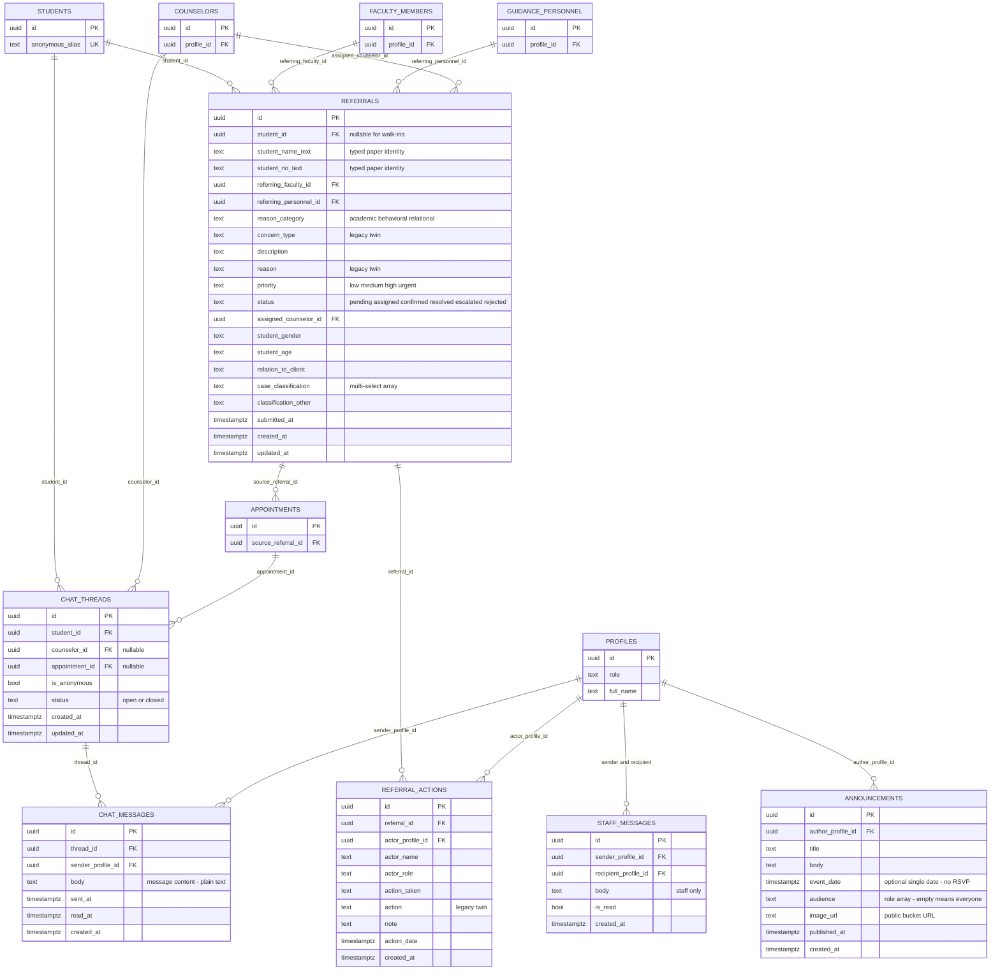
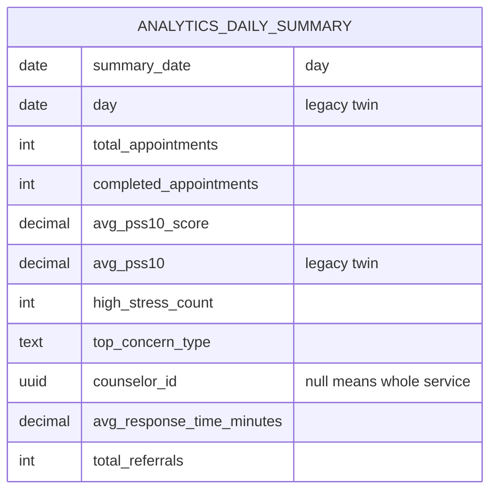

# Database Diagram and Schema Reference

This document maps the Supabase PostgreSQL schema: every table, the relationships that matter, which links are real foreign keys versus app-enforced UUID joins, and where sensitive data lives. The SQL migrations in `supabase/migrations/` are the source of truth; `packages/db/prisma/schema.prisma` is a dictionary mirror and does not model every table. Names here match the migrations exactly.

**Audience:** developers, database reviewers, and privacy/security assessors.

---

## 1. How to render

Every diagram in this file is Mermaid and renders on <https://mermaid.live>:

1. Open <https://mermaid.live>.
2. Paste one fenced block at a time, without the triple backticks.
3. The preview renders on the right; use **Actions → Download PNG/SVG** for a report.
4. If a block fails, split it at the domain boundary rather than deleting relationships.

The full schema is split into four diagrams by domain so each block stays readable. Together they cover all 27 tables and the one view.

---

## 2. Full ER diagrams

### 2.1 Identity, roles, and scheduling

### 2.2 Clinical record

### 2.3 Communication and referrals

### 2.4 Security, notifications, and platform

```mermaid
erDiagram
  PROFILES {
    uuid id PK
    text role
  }

  STUDENTS {
    uuid id PK
    text anonymous_alias UK
  }

  APPOINTMENTS {
    uuid id PK
    uuid student_id FK
  }

  BREAK_GLASS_LOGS {
    uuid id PK
    uuid accessor_profile_id FK "profiles.id"
    uuid counselor_id "soft link to counselors.id"
    uuid student_id FK
    uuid appointment_id FK "nullable"
    text justification "reason - 20 chars minimum"
    uuid approved_by FK "profiles.id"
    uuid reviewed_by FK "profiles.id"
    timestamptz reviewed_at
    timestamptz accessed_at
    timestamptz expires_at "default now plus 30 minutes"
  }

  AUDIT_LOGS {
    uuid id PK
    uuid actor_profile_id FK "nullable"
    text action
    text entity
    uuid entity_id "polymorphic soft link"
    text target_table
    uuid target_id "polymorphic soft link"
    jsonb metadata "must contain no names numbers or clinical text"
    text platform "web or mobile"
    timestamptz created_at
  }

  AUDIT_EVENTS {
    uuid id PK
    uuid actor_profile_id FK
    text actor_role
    text action
    text entity
    uuid entity_id
    text status_before
    text status_after
    jsonb diff "watched columns only"
    text reason
    text related_entity
    uuid related_id
    text source
    text result
    text request_id
    text ip
    timestamptz created_at
  }

  NOTIFICATIONS {
    uuid id PK
    uuid profile_id FK
    text type "appointment referral announcement chat assessment system"
    jsonb payload
    text title
    text body "no clinical content"
    text link
    text dedupe_key "unique per profile"
    bool is_read
    text tone "success info error"
    bool is_action_required
    timestamptz read_at
    text ref_type
    uuid ref_id
    timestamptz resolved_at
    timestamptz created_at
  }

  NOTIFICATION_DELIVERIES {
    uuid id PK
    uuid notification_id FK
    text push_token
    text status "queued sent failed skipped"
    jsonb provider_response
    timestamptz created_at
  }

  DEVICE_TOKENS {
    uuid id PK
    uuid profile_id FK
    text platform "ios android web"
    text push_token
    text device_label
    timestamptz last_active_at
    timestamptz created_at
  }

  REPORT_DIGESTS {
    uuid id PK
    timestamptz period_start
    timestamptz period_end
    jsonb payload "aggregates only"
    timestamptz created_at
    uuid delivered_to FK
  }

  BACKUP_RUNS {
    uuid id PK
    text status "running completed partial failed"
    text source "manual or cron"
    jsonb tables
    jsonb row_counts
    int total_rows
    int bytes
    text checksum
    text storage_path
    jsonb warnings
    text error
    uuid initiated_by FK
    timestamptz started_at
    timestamptz finished_at
  }

  WORKSPACE_SETTINGS {
    text key PK "office"
    jsonb value
    uuid updated_by FK
    timestamptz updated_at
  }

  PROFILES ||--o{ BREAK_GLASS_LOGS : "accessor and reviewer"
  STUDENTS ||--o{ BREAK_GLASS_LOGS : "student_id"
  APPOINTMENTS ||--o{ BREAK_GLASS_LOGS : "appointment_id"
  PROFILES ||--o{ AUDIT_LOGS : "actor_profile_id"
  PROFILES ||--o{ AUDIT_EVENTS : "actor_profile_id"
  PROFILES ||--o{ NOTIFICATIONS : "profile_id"
  NOTIFICATIONS ||--o{ NOTIFICATION_DELIVERIES : "notification_id"
  PROFILES ||--o{ DEVICE_TOKENS : "profile_id"
  PROFILES ||--o{ REPORT_DIGESTS : "delivered_to"
  PROFILES ||--o{ BACKUP_RUNS : "initiated_by"
  PROFILES ||--o{ WORKSPACE_SETTINGS : "updated_by"
```

**Read the ER notation as follows.** Solid edges are declared foreign keys. Where a column looks like a join but has no constraint (`appointments.updated_by`, `break_glass_logs.counselor_id`, `audit_logs.entity_id`, `audit_events.related_id`, `notifications.ref_id`), the connection reference below marks it `soft`. Mermaid ER diagrams cannot draw dashed edges, so soft links are listed in prose and in the table.

### 2.5 Analytics view

`analytics_daily_summary` is a **view**, not a table (migration `00019`, redefined additively in `00020`). It exposes counts and averages only:

---

## 3. Core workflow diagram

This is the flagship path only: booking, screening, session, notes, analytics. It is a flowchart rather than an ER diagram so the order is explicit.

```mermaid
flowchart LR
  A["Student opens /book"] --> B["Reads counselor_availability"]
  B --> C["bookAppointment inserts appointments row with status pending"]
  C --> D["submitPss10 inserts pss10_assessments row"]
  D --> E["Head opens /appointments and assigns counselor"]
  E --> F["appointments status assigned"]
  F --> G["Counselor confirms inside availability"]
  G --> H["appointments status confirmed plus meeting_url for online"]
  H --> I["Student attends and counselor opens /sessions"]
  I --> J["Complete or No-show guard checks latest PSS-10 within 7 days"]
  J --> K["session_notes row written by assigned counselor"]
  K --> L["Analytics RPCs read aggregates"]
  L --> M["Head exports workbook with suppression at 5"]
  K --> N["Follow-up appointment via follow_up_of"]

  classDef book fill:#dbeafe,stroke:#2563b8,color:#14315c
  classDef clinical fill:#dcfce7,stroke:#15803d,color:#14315c
  classDef analytics fill:#fff1c2,stroke:#b7791f,color:#14315c
  class A,B,C,D book
  class E,F,G,H,I,J,K,N clinical
  class L,M analytics
```

---

## 4. Connection reference

Cardinality is written `child → parent`. `Enforced` means a real SQL foreign key; `soft` means the column is a UUID join without a constraint. `on delete` comes from the migration/Prisma relation.

| From | Column | To | Cardinality | Enforced | on delete |
|---|---|---|---|---|---|
| `students` | `profile_id` | `profiles.id` | 1:1 | Yes | CASCADE |
| `counselors` | `profile_id` | `profiles.id` | 1:1 | Yes | CASCADE |
| `guidance_heads` | `profile_id` | `profiles.id` | 1:1 | Yes | CASCADE |
| `faculty_members` | `profile_id` | `profiles.id` | 1:1 | Yes | CASCADE |
| `guidance_personnel` | `profile_id` | `profiles.id` | 1:1 | Yes | CASCADE |
| `counselor_availability` | `counselor_id` | `counselors.id` | N:1 | Yes | CASCADE |
| `appointments` | `student_id` | `students.id` | N:1 | Yes | CASCADE |
| `appointments` | `counselor_id` | `counselors.id` | N:1 | Yes | SET NULL |
| `appointments` | `pss10_id` | `pss10_assessments.id` | N:1 | Yes | SET NULL |
| `appointments` | `source_referral_id` | `referrals.id` | N:1 | Yes | SET NULL |
| `appointments` | `follow_up_of` | `appointments.id` | N:1 self | Yes | SET NULL |
| `appointments` | `updated_by` | `profiles.id` | N:1 | **soft** | None |
| `pss10_assessments` | `student_id` | `students.id` | N:1 | Yes | CASCADE |
| `pss10_assessments` | `appointment_id` | `appointments.id` | N:1 | Yes | SET NULL |
| `session_notes` | `appointment_id` | `appointments.id` | N:1 | Yes | CASCADE |
| `session_notes` | `counselor_id` | `counselors.id` | N:1 | Yes | CASCADE |
| `session_note_attachments` | `note_id` | `session_notes.id` | N:1 | Yes | CASCADE |
| `session_note_attachments` | `counselor_id` | `counselors.id` | N:1 | Yes | CASCADE |
| `feedback` | `appointment_id` | `appointments.id` | 1:1 | Yes | CASCADE |
| `feedback` | `student_id` | `students.id` | N:1 | Yes | CASCADE |
| `chat_threads` | `student_id` | `students.id` | N:1 | Yes | CASCADE |
| `chat_threads` | `counselor_id` | `counselors.id` | N:1 | Yes | SET NULL |
| `chat_threads` | `appointment_id` | `appointments.id` | N:1 | Yes | SET NULL |
| `chat_messages` | `thread_id` | `chat_threads.id` | N:1 | Yes | CASCADE |
| `chat_messages` | `sender_profile_id` | `profiles.id` | N:1 | Yes | CASCADE |
| `staff_messages` | `sender_profile_id` | `profiles.id` | N:1 | Yes | CASCADE |
| `staff_messages` | `recipient_profile_id` | `profiles.id` | N:1 | Yes | CASCADE |
| `notifications` | `profile_id` | `profiles.id` | N:1 | Yes | CASCADE |
| `notification_deliveries` | `notification_id` | `notifications.id` | N:1 | Yes | CASCADE |
| `device_tokens` | `profile_id` | `profiles.id` | N:1 | Yes | CASCADE |
| `announcements` | `author_profile_id` | `profiles.id` | N:1 | Yes | RESTRICT |
| `referrals` | `student_id` | `students.id` | N:1 | Yes | CASCADE |
| `referrals` | `referring_faculty_id` | `faculty_members.id` | N:1 | Yes | SET NULL |
| `referrals` | `referring_personnel_id` | `guidance_personnel.id` | N:1 | Yes | SET NULL |
| `referrals` | `assigned_counselor_id` | `counselors.id` | N:1 | Yes | SET NULL |
| `referral_actions` | `referral_id` | `referrals.id` | N:1 | Yes | CASCADE |
| `referral_actions` | `actor_profile_id` | `profiles.id` | N:1 | Yes | RESTRICT |
| `break_glass_logs` | `accessor_profile_id` | `profiles.id` | N:1 | Yes | RESTRICT |
| `break_glass_logs` | `student_id` | `students.id` | N:1 | Yes | CASCADE |
| `break_glass_logs` | `appointment_id` | `appointments.id` | N:1 | Yes | SET NULL |
| `break_glass_logs` | `counselor_id` | `counselors.id` | N:1 | **soft** | None |
| `break_glass_logs` | `approved_by` | `profiles.id` | N:1 | Yes | SET NULL |
| `break_glass_logs` | `reviewed_by` | `profiles.id` | N:1 | Yes | SET NULL |
| `audit_logs` | `actor_profile_id` | `profiles.id` | N:1 | Yes | SET NULL |
| `audit_logs` | `entity_id`, `target_id` | any table | polymorphic | **soft** | None |
| `audit_events` | `actor_profile_id` | `profiles.id` | N:1 | Yes | SET NULL |
| `audit_events` | `entity_id`, `related_id` | any table | polymorphic | **soft** | None |
| `report_digests` | `delivered_to` | `profiles.id` | N:1 | Yes | SET NULL |
| `backup_runs` | `initiated_by` | `profiles.id` | N:1 | Yes | SET NULL |
| `workspace_settings` | `updated_by` | `profiles.id` | N:1 | Yes | SET NULL |
| `notifications` | `ref_id` | any table | polymorphic | **soft** | None |

### Why some links are soft

- `updated_by` is attribution written by service-role code and intentionally not constrained, so a deleted staff profile does not erase the appointment.
- `break_glass_logs.counselor_id` is a denormalized convenience; the enforcement column is `accessor_profile_id`.
- Audit and notification `ref_id`/`entity_id` columns are polymorphic by design (one trail for many entities), so they cannot be single-table foreign keys.
- `appointments.source_referral_id` and `follow_up_of` are real FKs but nullable; analytics treats them as optional lineage.

---

## 5. Privacy map

### 5.1 Identifying columns

| Column | Identifies | Encrypted | Pseudonymized | Who may read |
|---|---|---|---|---|
| `profiles.email` | Student/staff | No (Supabase disk encryption only) | No | Owner, head/admin; not routine staff for students |
| `profiles.full_name` | Student/staff | No | No | Owner, head/admin; not routine staff for students |
| `profiles.id_number` | Staff/student | No | No | Head/admin; referral lookup returns only what the form needs |
| `profiles.contact_number` | Staff/student | No | No | Owner and head/admin |
| `students.student_no` | Student | No | No | Student owner, head/admin, exact referral lookup, break-glass |
| `students.contact_no` | Student | No | No | Student owner, head/admin, break-glass |
| `students.anonymous_alias` | Pseudonym | No | **Yes** — replaces identity in routine staff views | Routine staff |
| `referrals.student_name_text`, `student_no_text` | Walk-in identity | No | No | Referring faculty, assigned counselor, head |
| `appointments.meeting_url` | Join link | No | No | Appointment participants and staff with row access |
| `chat_messages.body` | Free text | No | No | Thread participants and head/admin oversight |
| `session_notes.notes`, `content`, S.O.A.P. columns | Clinical content | **No — plain text** | No | Assigned counselor and head/admin |
| `pss10_assessments.answers`, `item_scores`, `total_score` | Clinical score | No | Linked by student id | Student owner, assigned counselor through scoped reads, head aggregates |
| `feedback.comment` | Free text | No | No | Counselor/head feedback views |
| `break_glass_logs.justification` | Free text | No | No | Counselor/head security console |

**Honest limitation:** there is no field-level encryption, no key vault, and no encrypted-column type in the migrations. The only encryption is the platform's at-rest storage encryption. The Prisma comment that says session notes are “encrypted at rest by the app layer” (`packages/db/prisma/schema.prisma:438-440`) is **not implemented**; treat it as aspirational.

### 5.2 Alias-level fields

These are deliberately exposed to routine staff through scoped RPCs and alias joins:

- `students.id`
- `students.anonymous_alias`
- `students.program`, `students.year_level`, `students.college`
- `students.created_at`
- Aggregates derived from appointments, referrals, screenings, and chat

`get_student_aliases(ids)` returns `profile_id` only so notifications can address the student's inbox; profiles RLS prevents routine staff from resolving it (`docs/security/anonymity-threat-model.md:68-73`).

### 5.3 Who reads what

| Role | Student identity | Alias and workload | Notes | Break-glass log | Audit |
|---|---|---|---|---|---|
| Student | Own | Own | Never | Never | Never |
| Counselor | Caseload through reveal only | Caseload | Assigned sessions | Own requests | No |
| Faculty | Exact referral lookup only | Referral participants | No | No | No |
| Guidance head | Broad oversight | All | Read oversight | All | Yes |
| Admin | Broad oversight | All | Read oversight | All | Yes |
| Service role | All | All | All | All | All |

---

## 6. Invariants and gotchas

1. **Double-booking is blocked in the database.** The exclusion constraint `no_counselor_overlap` prevents overlapping `assigned`/`confirmed` windows for one counselor using `btree_gist` and `tstzrange(scheduled_at, ends_at)` (`supabase/migrations/00059`, repaired and re-armed in `00067`). A conflict raises `23P01`, which the app maps to “That time was just taken.”
2. **`ends_at` is filled by a trigger.** `set_appointment_ends_at` sets `ends_at = scheduled_at + 1 hour` when null and preserves duration on reschedule (`00067`). The constraint needs a non-null range endpoint.
3. **Booking is idempotent.** `appointments.idempotency_key` is unique; retries with the same client key collapse to one row (`00021`, `00046`). Null keys never conflict, so legacy writes still work.
4. **Availability windows are not uniquely constrained.** `counselor_availability` has indexes on `counselor_id` and `weekday` but no exclusion constraint; overlapping windows are prevented by app validation, not the database.
5. **Appointment status machine.** The DB check allows `pending`, `assigned`, `confirmed`, `completed`, `cancelled`, `rejected`, `no_show` (`00029`). Transitions are enforced by guarded updates in `packages/shared-services/src/appointments/mutations.ts` (`pending → assigned → confirmed → completed`, with `no_show`, `cancelled`, and `rejected` branches). There is no transition table.
6. **One PSS-10 per appointment is no longer unique.** `00068` dropped `pss10_appointment_unique` to allow retakes and replaced it with `pss10_appointment_created_idx (appointment_id, created_at desc)`. Readers take the latest row.
7. **PSS-10 integrity.** `answers` must have length 10; `total_score` must be 0–40; `band` must be `low`, `moderate`, or `high` (`00008`). Scoring and reverse-scoring live in `packages/shared-services/src/assessments/pss10-scoring.ts`.
8. **Pre-session gate.** Completion requires a linked PSS-10 submitted within seven days before the session, or an audited waiver of 10–500 characters (`00068`; `pre-session-pss10.ts`). A waiver is operational context, never clinical detail.
9. **Feedback is one per appointment.** `feedback.appointment_id` is unique.
10. **Session notes are one per appointment by application convention only.** The table has an index, not a unique constraint, so the “one note per session” rule is enforced in the service/API layer.
11. **Alias lifecycle is static.** The alias is generated during student bootstrap, stored on `students.anonymous_alias`, and never rotated. There is no alias history table. Re-identification is possible through the same row, by design, for break-glass.
12. **Break-glass grants expire.** `break_glass_logs.expires_at` defaults to `now() + 30 minutes`; the reveal route checks an active grant, head review, caseload, and expiry (`00027`, `00069`).
13. **Audit is append-only for clients.** `audit_logs` and `audit_events` expose no UPDATE/DELETE policies; `audit_events` rows are written by `SECURITY DEFINER` triggers in the same transaction as the business write (`00045`). Service-role and database administrators can still write directly.
14. **Notifications are deduplicated.** `UNIQUE(profile_id, dedupe_key)` prevents duplicate fan-out for one event; the push ledger adds `UNIQUE(notification_id, push_token)` (`00021`).
15. **Analytics suppresses small cells.** `MIN_CELL = 5`; cells and cohort denominators below five are withheld before display and export (`packages/shared-services/src/analytics/suppression.ts`).
16. **Meeting links are validated, not secret.** Online confirmation requires a `meet.google.com` URL, but the URL is stored in plain text and is readable by anyone with row access.
17. **Status spelling is mixed for compatibility.** Dictionary values (`canceled`, `face_to_face`) coexist with legacy values (`cancelled`, `in_person`) in the enum mirror; the running UI uses `cancelled` and `in_person`/`online`. Documents in this suite use `cancelled` to match the live check constraint.
18. **Soft-deleted identity is not modeled.** Deactivation is `profiles.is_active = false` / `status = 'deactivated'`; rows are not erased.

---

## 7. Cascade and delete map

| Delete target | Effect |
|---|---|
| `profiles` | Cascades to `students`, `counselors`, `guidance_heads`, `faculty_members`, `guidance_personnel`, `device_tokens`, `notifications`; sets audit actor, reviewer, approver, digest recipient, backup initiator, settings updater to null; restrict on `announcements` and `referral_actions` actors. |
| `students` | Cascades to appointments, PSS-10 rows, chat threads, feedback, referrals, break-glass logs. |
| `counselors` | Cascades availability, session notes, attachments; sets appointment/thread/referral counselor to null. |
| `appointments` | Cascades session notes and feedback; sets PSS-10 appointment link, chat thread link, break-glass link, and follow-up link to null. |
| `session_notes` | Cascades attachment metadata; storage objects are handled by the API, not the FK. |
| `chat_threads` | Cascades messages. |
| `referrals` | Cascades actions; sets `appointments.source_referral_id` to null. |
| `notifications` | Cascades delivery ledger rows. |

**Operational note:** the office does not expose delete buttons for clinical rows; deletion is an administrative/database action. Backups are logical exports, not a restore button (`docs/operations/backup-restore.md`).

---

## 8. Index rationale for hot queries

| Index | Query it serves | Why |
|---|---|---|
| `appointments (counselor_id, status, scheduled_at desc)` | Counselor day/session board | Covers filter + sort in one scan (`00059`). |
| `appointments (status, scheduled_at desc)` | Head appointment queue | Status buckets with recency ordering. |
| `appointments (student_id, scheduled_at desc)` | Student record timeline | One student's sessions in reverse time (`00070`). |
| `appointments_student_scheduled_idx` | Record timeline | Added with the student record. |
| `no_counselor_overlap` exclusion | Confirm/reschedule writes | Race-proof slot guard. |
| `pss10_appointment_created_idx (appointment_id, created_at desc)` | Latest check-in per session | Retakes make “latest wins” the read pattern (`00068`). |
| `pss10_student_created_idx` | Student screening history | Trend and record reads. |
| `chat_messages (thread_id, created_at)` | Conversation load | Ordered page per thread. |
| `notifications (profile_id, is_read, created_at desc)` | Inbox and bell | Unread-first list. |
| `referrals (assigned_counselor_id, status, created_at desc)` | Counselor referral queue | Scoped triage list. |
| `referrals (status, created_at desc)` | Head referral pipeline | Status buckets. |
| `audit_events (entity, entity_id, created_at desc)` | Entity audit trail | Fast per-record history. |
| `session_note_attachments (note_id)` | Note attachments | One note's files. |
| `backup_runs (started_at desc)` | Backup history | Newest first. |

---

## 9. Schema gaps and proposals

| Gap | Current state | Target design (`PROPOSED`) |
|---|---|---|
| Field-level encryption | None; notes and messages are plain text | Envelope-encrypt note bodies and attachment keys with a KMS-managed key; store ciphertext plus key version. |
| Consent capture | No table | `consents (id, profile_id, type, version, granted_at, revoked_at, evidence)` with append-only history. |
| Alias rotation | None | `student_aliases (alias, student_id, valid_from, valid_to, reason)` and rotation on a defined schedule. |
| Events and RSVP | `announcements` only, optional `event_date` | `events`, `event_audiences`, `event_rsvps` with capacity and attendance. |
| Status history | Audit tables only | `appointment_status_history` if reporting needs a first-class transition log. |
| Session-note uniqueness | App convention | Add `UNIQUE(appointment_id)` if one-note-per-session must be a database invariant. |
| Deletion/retention | Deactivation only | Retention policy table and scheduled purge with legal hold. |
| Break-glass grants | Log row doubles as grant | Separate `break_glass_grants` with approver, scope, and revocation if the workflow grows. |
