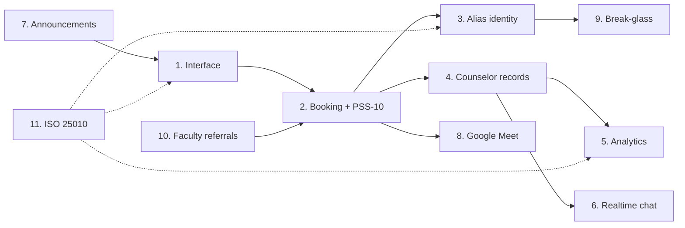

# System Objectives — Where to See Them and How They Work

This guide maps the **eleven study objectives** to the actual screens, roles, services, tables, and evidence in DCAS. It is written for the question a panel actually asks:

- *Where in the system can I see this objective being delivered?*
- *Which role does this, and on which device?*
- *How does it work under the hood?*
- *What should I show a reviewer?*
- *What is the honest limit?*

The companion documents are [OBJECTIVE_STATUS.md](../../OBJECTIVE_STATUS.md) for the plain-language version and [Objective_Achievement_Report.md](../../Objective_Achievement_Report.md) for the full technical audit. This document sits between them: enough detail to defend a claim, without turning the defense into a code review.

> **The objectives as stated**
>
> 1. Provide a user-friendly web and mobile interface for students, counselors, and the guidance head.
> 2. Allow students to book, reschedule, and cancel counseling appointments, with a PSS-10 stress screening before the session.
> 3. Protect student confidentiality through a secure anonymous identity.
> 4. Give counselors a dashboard for schedules, student records, and session documentation.
> 5. Collect counseling data, identify student stress trends, and generate reports for the guidance head.
> 6. Enable real-time chat between students and guidance staff.
> 7. Publish announcements and activities to the right audience.
> 8. Attach a Google Meet link to online counseling sessions.
> 9. Provide break-glass emergency access to a student's identity, with audit.
> 10. Let faculty refer a student for counseling and track the referral.
> 11. Evaluate the system against ISO/IEC 25010 software-quality characteristics.

**The rule for this document:** code and migrations win. Where the objective wording promises more than the repository implements, the gap is stated in **Honest limit** rather than smoothed over. A panel that finds one overclaim will doubt everything else; naming the limit first is the stronger position.

**Status labels used here**

- **Implemented** — the end-to-end path exists, is wired to Supabase, and has supporting tests or constraints.
- **Partial** — the core exists, but a stated promise is missing, narrowed, or unmeasured.
- **Proposed** — a design only; no code exists.

---

## 1. Quick navigation

Use this table when you need the first screen for an objective, not the full argument.

| # | Objective | Best first screen | Main role | Verdict |
|---:|---|---|---|---|
| 1 | User-friendly interface | Mobile Home; web `/dashboard` | Student / staff | **Partial** (built, not measured) |
| 2 | Booking + PSS-10 | Mobile `/book` -> `/check-in`; web `/appointments` | Student, head, counselor | **Implemented** |
| 3 | Anonymous identity | Web `/emergency` and `/security` | Counselor, head | **Implemented** (pseudonymity) |
| 4 | Counselor dashboard and records | Web `/dashboard`, `/sessions`, `/students/[id]` | Counselor | **Implemented** |
| 5 | Analytics and reports | Web `/reports` | Head | **Implemented** |
| 6 | Real-time chat | Mobile `/chat`; web `/chat` | Student, counselor | **Implemented** |
| 7 | Announcements | Web `/announcements`; mobile Home | Head | **Partial** (scope narrowed) |
| 8 | Google Meet link | Web confirm dialog on `/appointments` | Counselor | **Implemented** |
| 9 | Break-glass + audit | Web `/emergency`, `/security` | Counselor, head | **Implemented** |
| 10 | Faculty referrals | Web `/refer-student`, `/referrals` | Faculty, head, counselor | **Implemented** |
| 11 | ISO/IEC 25010 evaluation | CI, test suites, `perf-tests/` | Developers | **Partial** (evidence gaps) |

**Nine objectives are implemented. Objectives 1, 7, and 11 are partial.** Objective 1 is partial only for evidence: the interface exists but has not been measured with participants. Objective 7 is partial because the scope was narrowed from event management to announcement management. Objective 11 is partial because the evaluation instrument is not fully exercised.

### How the objectives connect

The objectives are not eleven separate features. They form one loop: the student books (2), the office keeps identity private (3), the counselor works from a schedule and record (4), the head reads the aggregate (5), chat and announcements keep people informed (6, 7), online sessions need a link (8), emergencies need a controlled exception (9), faculty feed the loop with referrals (10), and the interface and evaluation cover the whole thing (1, 11).

Read the diagram left to right as the care path, and the dotted lines as the evaluation covering the interface, privacy, and analytics claims.

---

## 2. Who does what

Roles come from `packages/shared-types/src/database.ts` and `packages/shared-services/src/rbac.ts`. The important thing for a demo is not the permission matrix but the platform split:

- **Students are mobile-only.** The web staff layout rejects the student role.
- **Counselors, faculty, and the guidance head are web-only.** There is no staff mobile app.
- **The administrator account is deliberately narrow.** It can reach `/settings`; office administration belongs to `guidance_head`.
- **`guidance_personnel` has no policy entry in this revision**, so it cannot reach any page even though the type exists.

The working roles:

| Role | Device | What they own |
|---|---|---|
| Student | Mobile | Book, check in, attend, chat, rate, manage profile. |
| Counselor | Web | Confirm and complete sessions, write notes, keep availability, read records, handle referrals. |
| Guidance head | Web | Assign requests, read office analytics, manage accounts, publish announcements, review break-glass, run backups. |
| Faculty | Web | File referrals by exact student number and track their own referrals. |
| Admin | Web | Own settings only. |

Two consequences that are worth saying out loud during a demo:

1. A student cannot log in on the web portal. That is a design decision, not a missing page.
2. A counselor cannot install a staff app. The web portal is the staff surface.

---

## 3. The objectives

### Objective 1 — A user-friendly interface for students, counselors, and the guidance head

**Status: Partial.** The interface is built, consistent, and role-aware. What is missing is proof from real users: no usability study, no SUS score, no task-success rate, no time-on-task, and no WCAG audit has been run.

#### Where to see it

Students meet the system through the Expo app: the first-run onboarding carousel, then `/login` or `/register`, then the Home tab, the two-step booking flow, the check-in screen, the Sessions tab, Chat, and Profile. The visual language is cream, ink, blue, and sun; tap targets are large, errors are short and actionable, and empty/loading states are designed rather than left blank.

Staff meet the system through the web portal. One shell (`staff-shell.tsx`) and one navigation definition (`staff-nav.tsx`) serve every staff role, and the sidebar hides links a role cannot open. Counselors land on `/dashboard`; the guidance head sees the same shell with more pages; faculty see their referral surface. `/about` is a plain-language staff handbook that explains the pipeline and each page, which is useful during onboarding and during a demo.

The split is deliberate: **students = mobile, staff = web**. There is no student web portal and no counselor mobile app.

#### How it works

The web shell filters navigation through `rbac.ts` before rendering, so a counselor does not see `/users` and a faculty member does not see `/students`. The mobile app uses `theme.ts` as the single token source for colour, type, spacing, and radii; the web consumes `@dorsu/ui-tokens` through Tailwind. Both clients use sentence-case microcopy and the same brand palette, so the two surfaces feel like one product even though they run on different stacks.

The interface also carries the safety language. The check-in screen says the result is private and only the counselor sees it. The booking screen explains the alias toggle in plain words. The emergency screen explains that access is logged and time-limited. Usability here is not only about fewer clicks; it is about making the privacy model understandable before the user needs it.

#### What to show a reviewer

1. Open the mobile app to the onboarding carousel and tap through to Home.
2. Point out the next-session card, the announcement, the mood self-check, and the quick actions.
3. Book a session: concern -> mode -> day -> slot -> alias toggle -> Continue.
4. Show the check-in screen and the sentence that says only the counselor sees the result.
5. Switch to the web portal and sign in as a counselor. Show that the sidebar contains only counselor pages.
6. Open `/about` and show that the staff handbook explains the same pipeline in plain language.

#### Honest limit

The interface has not been evaluated with non-technical participants. There is no SUS score, no task-success rate, and no time-on-task measurement. The protocol exists in [`docs/ux/usability-accessibility-protocol.md`](../ux/usability-accessibility-protocol.md), but no sessions have been run. There is also no WCAG or screen-reader audit, so accessibility is designed for rather than demonstrated. Say "built and reviewed, not yet measured," not "proven usable."

---

### Objective 2 — Booking, rescheduling, cancellation, and a PSS-10 before the session

**Status: Implemented.** This is the flagship workflow and the most defensible objective in the system.

#### Where to see it

The student books on mobile `/book` and completes the PSS-10 on `/check-in`. The guidance head assigns a counselor on web `/appointments`. The counselor confirms, reschedules, completes, or marks a no-show on `/appointments` and `/sessions`. The student cancels, reschedules, and rates from the mobile Sessions tab.

#### How it works

Booking starts with real availability, not a free-text time. The student picks a concern, a mode (in person or online), a day within the next seven days, and a slot from `counselor_availability`. If they want to be known by an alias, they turn on **Book under my alias**. Submitting the PSS-10 creates the appointment as `pending` with an idempotency key, so a network retry does not duplicate the request.

The guidance head assigns a counselor, moving the row to `assigned`. The counselor confirms a final time inside their own availability, moving it to `confirmed`. For an online session, confirmation requires a `meet.google.com` link, either created through the Google API or pasted manually. The student is notified with the schedule and the link.

Completion is gated. The counselor can complete only when there is a PSS-10 linked to that appointment and submitted within **seven days before** the scheduled start, or when the counselor records an operational waiver of **10–500 characters**. The waiver is audited, and the audit row records the fact of the waiver, never the check-in answers or score. A separate booking gate requires a PSS-10 within **30 days**. A confirmed session can be moved by the student until **24 hours** before start; inside that window the app tells the student to contact the Guidance Office.

Two guards are worth explaining because they are database guarantees, not screen tricks. First, booking is idempotent. Second, double-booking is blocked by a slot exclusion constraint plus guarded updates: a 50-way concurrent confirmation test produced **1 success and 49 `23P01` rejections**. The losing caller sees "That time was just taken," not a corrupted schedule.

#### What to show a reviewer

1. On mobile, book a session with the alias toggle on and answer the PSS-10.
2. Show the request as `pending` in the student's Sessions tab.
3. On web as the head, open `/appointments` and assign the counselor.
4. On web as the counselor, confirm the session inside availability and add a Meet link.
5. Return to mobile and show the confirmed session with the counselor, time, and join link.
6. As the counselor, complete the session. If there is no linked check-in, show the waiver dialog and its 10–500 character rule.
7. Open the notes editor and show the freeform/S.O.A.P. choice.

#### Honest limit

The "one note per session" rule is enforced in the app, not by a database constraint. PSS-10 retakes are allowed, and readers take the latest linked row. The slot exclusion constraint protects `assigned` and `confirmed` windows, not every possible availability window. These are real but narrow gaps, and none of them breaks the main flow.

---

### Objective 3 — Secure anonymous identity

**Status: Implemented, with a precise definition.** This is pseudonymity plus audited re-identification. It is not mathematical anonymity.

#### Where to see it

The student turns anonymity on during booking. Staff see the alias in `/appointments`, `/sessions`, `/students`, `/chat`, `/reports`, and `/feedback`. The real identity is revealed only on `/emergency`, and the review happens on `/security`. The audit trail is on `/security/events`.

#### How it works

`students.anonymous_alias` is the routine staff identifier. Migration `00069_identity_rls_hardening.sql` denies routine staff direct reads of student identity, so the protection is in Postgres, not only in the page. Faculty referrals use an exact student-number lookup rather than a browse-all directory, which prevents a teacher from enumerating the student body.

When a counselor genuinely needs a real identity in an emergency, they open `/emergency`, choose the alias, and write a justification of at least **20 characters**. That creates a `break_glass_logs` row with `expires_at = now() + 30 minutes`. A counselor's reveal waits for the guidance head to review the grant. The head can reveal without a separate review because the head is the reviewer. The reveal route checks the active grant, the review state, the **caseload** (`isStudentOnCounselorCaseload`), and the expiry. Every log, review, and reveal writes an audit row.

This is the right sentence for the defense: **"Alias by default; identity only through logged break-glass."**

#### What to show a reviewer

1. Book or inspect an appointment and show the alias in the staff view.
2. Search `/students` and show that the directory is alias-based.
3. Open `/emergency`, pick the alias, and type a justification shorter than 20 characters. Show that it is rejected.
4. Type a valid justification and log the grant. Show the 30-minute expiry.
5. Open `/security` as the head and review the grant.
6. Return to `/emergency` and reveal the identity.
7. Open `/security/events` and show the audit row that records who, when, and why.

#### Honest limit

The alias-to-identity mapping exists in the same database, so service-role code and database administrators can correlate records. There is no alias rotation and no alias history table. Note bodies, chat messages, and PSS-10 answers are not field-level encrypted. What the system guarantees is narrower and more honest: **a normal staff browser session cannot see identity without an audited, time-limited, reviewed action.** Do not claim anonymity in the mathematical sense.

---

### Objective 4 — Counselor dashboard, schedules, records, and notes

**Status: Implemented.**

#### Where to see it

The working surface is the web portal: `/dashboard` for the queue and today's sessions, `/appointments` for the full board, `/sessions` for the month/week/day calendar, `/availability` for booking windows, `/students` for the alias directory, `/students/[id]` for one student's case timeline, and the notes dialog on a completed session.

#### How it works

The dashboard is a to-do list, not a static report. It shows today's sessions, requests waiting for confirmation, the referral queue, unread messages, and sessions that still need a note, with each item linking to the page that owns the action.

Board reads use per-domain React Query hooks (`use-*-board.ts`) with pagination, `keepPreviousData`, and incremental `patchBoard`. Realtime events patch the same cache, so the board does not poll or fully refetch on every change. That is why a busy office does not melt the database during a demo.

The student record is deliberately metadata-first. A single RPC returns one timeline grouped by month: sessions, referrals, screenings, feedback, note markers, and follow-ups. Note bodies are fetched on demand when the counselor opens a specific note, not in the bulk timeline. That is a privacy decision, not a missing feature.

Session documentation is per-session and structured. After completion, the counselor writes one note in freeform or S.O.A.P. format (Subjective, Objective, Assessment, Plan). Only the assigned counselor writes; the guidance head may read for oversight. A documented follow-up can create or move a confirmed follow-up appointment through `follow_up_of`. Attachments go through a privileged route into a private bucket, up to five per note.

#### What to show a reviewer

1. Sign in as a counselor and land on `/dashboard`. Point out the queue and today's sessions.
2. Open `/appointments` and confirm an assigned request.
3. Open `/sessions` and switch between month, week, and day views.
4. Complete a confirmed session and write a S.O.A.P. note.
5. Open `/students`, choose the alias, and show the month-grouped timeline.
6. Point out that note bodies open on demand rather than loading in the timeline.
7. Open `/availability` and show how a window scopes booking and confirmation.

#### Honest limit

The record is not a single free-text case narrative; it is a timeline of records with per-session notes. Note bodies are plain text at rest, with platform disk encryption only. The "one note per session" rule is app-enforced. Heads can read notes for oversight but do not author them.

---

### Objective 5 — Analytics, stress trends, and guidance-head reports

**Status: Implemented.**

#### Where to see it

Everything is on web `/reports`, scoped by role. The head sees office-wide aggregates, the counselor sees their own caseload report, and faculty see their own-referral report. The sections are sessions, referrals, feedback, screenings, wellbeing trend, cohort stress, and data quality. Filters cover date range and cohort grouping (program, year level, or college). Export produces an Excel workbook, and the head also gets an in-app digest.

#### How it works

The head-only RPCs return aggregates, not raw rows: `head_appointment_daily_counts`, `head_referral_status_counts`, `head_wellbeing_trends`, `head_cohort_stress`, `head_data_quality`, and `head_report_digest`. `analytics_daily_summary` backs the daily view. `report_digests` stores the generated summary. Counselor and faculty routes return scoped payloads rather than office-wide data.

The wellbeing trend is the objective's "stress trends" claim: daily screening volume, band mix, and average score over time, with cohort breakdowns by program, year level, or college. This is descriptive analytics, which is what the objective asks for. Predictive modelling is explicitly out of scope.

Privacy is built into the numbers. `MIN_CELL = 5` suppresses any cell below five before display and export, so a small cohort cannot be re-identified from a report. The data-quality panel surfaces missing notes, unlinked screenings, unassigned referrals, feedback coverage, and summary freshness rather than hiding them. A number that looks blank is usually a suppressed cell, not a bug.

#### What to show a reviewer

1. Sign in as the head and open `/reports`.
2. Choose a date range and switch the cohort grouping between program, year level, and college.
3. Show the wellbeing trend panel and explain daily volume, band mix, and average score.
4. Open the data-quality panel and point out missing notes and unlinked screenings.
5. Show a suppressed cell and explain the smaller-than-five rule.
6. Export the Excel workbook and open the quality/trends sheet.
7. Point out that the digest is in-app, not emailed.

#### Honest limit

There is no predictive model and no forecasting; the objective asks for trends, and longitudinal/cohort views provide them. The digest is not emailed. Aggregates are only as trustworthy as the underlying records, which is why the data-quality panel exists instead of a clean-looking dashboard that hides gaps. These are staging measurements and office data, not a longitudinal research dataset.

---

### Objective 6 — Real-time chat

**Status: Implemented.**

#### Where to see it

Students use mobile `/chat`: an inbox of counselors, then a conversation. Staff use web `/chat`: threads, unread counts, and notifications. Faculty can message counselors and the head about a referral, but the student-facing thread is between the student and their counselor.

#### How it works

`messageableCounselors` limits the student inbox to counselors from that student's confirmed or completed sessions. There is no anonymous "Guidance Office" thread, and a student cannot open a conversation with a counselor they have never been assigned. `openThread` reuses the one thread per student-counselor pair. `sendMessage` persists the message and triggers a generic notification. Realtime subscriptions patch the thread and unread badges without a refresh, and opening a conversation clears unread chat notifications.

The safety rule is in the payload, not only the screen. Realtime events carry IDs and status, never message bodies. Notifications say a new message arrived; they do not quote it. Chat sends are audited as "who sent, in which thread, when," not as content. Migration `00074_counselor_directory_role.sql` keeps the contact directory limited to actual participants.

#### What to show a reviewer

1. Open mobile Chat as a student and show the counselor list.
2. Open a thread and send a message.
3. Switch to web `/chat` as the counselor and show the message arriving without a refresh.
4. Reply from the web side and show it arrive on mobile.
5. Point out the unread badge and the notification.
6. Explain that the realtime payload carries IDs, not the message text.

#### Honest limit

There is no typing indicator, no verified read receipt, and no offline queue. Messages require a live connection. A closed thread stays readable but read-only until the office reopens it. Chat is coordination, not a crisis service; the UI and user guide say so.

---

### Objective 7 — Announcement management

**Status: Partial.** The capability works, but the scope is narrower than the original event-management wording.

#### Where to see it

The guidance head composes, drafts, publishes, unpublishes, deletes, and reads insights on web `/announcements`. Counselors and faculty read targeted posts on the same page. Students read the feed on mobile Home.

#### How it works

`announcements` stores a title, body, audience role array, optional `event_date`, optional image URL, and `published_at`. Drafts have no `published_at` and are hidden from non-head staff. Publishing fans out notifications to the targeted roles. Images live in the public `announcement-images` bucket with head-only writes. The insights tab reads reach and engagement counts such as published, draft, with image, and audience mix.

#### What to show a reviewer

1. Sign in as the head and open `/announcements`.
2. Compose a post and target it at students.
3. Save it as a draft and show that it is not visible on mobile.
4. Publish it and show it appear on the student Home feed.
5. Open the insights tab and show the counts.
6. Unpublish or delete the post and show the feed update.

#### Honest limit

This is **announcement management, not event management.** There is no event calendar, venue, date range, capacity, RSVP, or attendance tracking. `event_date` is a single optional date on a post. There is no email delivery. The narrowing is recorded in [`objective-7-announcement-scope.md`](./objective-7-announcement-scope.md), and the right move is to state it before the panel asks.

---

### Objective 8 — Google Meet link for online counseling

**Status: Implemented.**

#### Where to see it

The counselor creates or pastes a link in the confirm dialog on `/appointments` and in referral confirmation. Join and remove actions appear on the appointment row and session detail. The student receives the link in the confirmation notification and on the session card.

#### How it works

`POST /api/appointments/meet` calls Google Calendar/Meet server-side when credentials are configured. The confirm dialog also accepts a pasted `meet.google.com` link. `packages/shared-services/src/appointments/meeting.ts` validates the URL and provider, and the link is stored on the appointment alongside `meeting_provider`, `meeting_event_id`, and `meeting_created_at` (migration `00072`). Reschedule moves the calendar event; rejection cleans it up.

The fallback is the important design choice. If `GOOGLE_MEET_ENABLED` or the OAuth credentials are missing, the create route returns 503 and the counselor can paste a link manually. The feature degrades rather than breaks, which matters on demo day.

#### What to show a reviewer

1. Confirm an **Online** session as a counselor.
2. Show the two paths in the dialog: **Create Meet link** and **paste**.
3. Paste a `meet.google.com` link and show that a non-Meet URL is rejected.
4. Confirm the session and show the link on the appointment row.
5. Return to mobile and show the link in the session detail or confirmation notification.
6. Reschedule the session and explain that a managed calendar event moves with it.

#### Honest limit

Automatic creation needs `GOOGLE_MEET_ENABLED`, OAuth credentials, and a refresh token. There is no per-counselor Google login; the office account is used. The URL is stored in plain text, so anyone who can read the appointment row can read the link. Testing-mode OAuth refresh tokens expire after seven days.

---

### Objective 9 — Break-glass emergency access with audit

**Status: Implemented.**

#### Where to see it

The counselor or head logs access and reveals on `/emergency`. The head reviews grants on `/security` and reads the trail on `/security/events`.

#### How it works

`breakGlassAccess` validates a justification (minimum 20 characters) and inserts a `break_glass_logs` row with a 30-minute expiry. The reveal route checks the active grant, the head's review, the counselor's caseload, and the expiry before returning identity. A database trigger appends the audit record. The head can reveal without a separate review because the head is the reviewer.

The audit row deliberately records operational facts, not clinical content: who asked, for which alias, the justification, when the grant was created, when it was reviewed, and when it was used. It does not copy the student's notes or check-in answers.

#### What to show a reviewer

1. Open `/emergency` as a counselor and choose an alias on the caseload.
2. Enter a short justification and show the 20-character rejection.
3. Enter a valid justification and log the grant.
4. Show that the reveal is blocked before review.
5. Switch to the head, open `/security`, and review the grant.
6. Return to the counselor and reveal the identity.
7. Open `/security/events` and show the log, review, and reveal rows.
8. Show that an expired grant cannot be reused.

#### Honest limit

There is no automatic alert pushed to the head; the head sees unreviewed entries in the console. The full expiry/review path is covered by unit and RLS tests but not by a browser-driven end-to-end test. Realtime payloads must stay ID-only. Break-glass does not protect against a database administrator, and it does not encrypt the identity fields.

---

### Objective 10 — Faculty referral feature

**Status: Implemented.**

#### Where to see it

Faculty file referrals on `/refer-student`, track them on `/referrals`, and see their history on `/dashboard` and `/reports`. The head assigns or rejects on `/referrals`. The counselor confirms, resolves, escalates, or rejects on the same board.

#### How it works

`createReferral` validates the input and writes the referral plus the first `referral_actions` row. Faculty must enter the **exact student number**; the lookup returns one match rather than a browse-all directory, which keeps the student body from being enumerable. The head triages and assigns. The counselor confirms with `confirmReferralWithSession`, which creates or links a real appointment through `appointments.source_referral_id` instead of duplicating the record. Resolution and escalation are explicit actions with reasons, and every move leaves a trail row.

Faculty see status and the action trail, never clinical notes, check-in answers, or another faculty member's referrals. The paper referral form is digitized in the UI and export; it is not a scanned image.

#### What to show a reviewer

1. Sign in as faculty and open `/refer-student`.
2. Look up a student by exact student number and show the single match.
3. Complete the concern, priority, and case classification, then submit.
4. Open `/referrals` as the head and assign a counselor.
5. Sign in as the counselor and confirm the referral into a session.
6. Show that the session links through `source_referral_id` rather than creating a duplicate.
7. Resolve the referral with an outcome note and show the updated trail back on the faculty view.

#### Honest limit

Faculty use the web only; there is no faculty mobile app. Referral letters are in-app only; there is no external email delivery. The paper form is digitized, not scanned. Faculty cannot see counseling notes or check-in results.

---

### Objective 11 — ISO/IEC 25010 evaluation

**Status: Partial.** The evaluation has real performance and automated-test evidence, but it is not complete.

#### Where to see it

The evidence lives in `perf-tests/` (page load, booking, mutations, concurrency, realtime, query plans), `packages/shared-services/**/*.test.ts` (86 Vitest cases across 9 files), `tests/rls/` (14 RLS cases), `e2e/specs/` (4 Playwright specs containing 6 tests), and `.github/workflows/ci.yml`. The written evaluation is [`docs/quality/iso-25010-evaluation.md`](../quality/iso-25010-evaluation.md).

#### How it works

The performance harness records JSON results for page load, booking, mutations, concurrency, realtime, and query plans. The unit suite covers PSS-10 integrity and scoring, booking gates, idempotency, slot races, Meet URL validation, RBAC, and suppression. The RLS suite exercises real Postgres policies: cross-student and cross-role isolation, note privacy, audit scope, and alias-only timeline reads. Playwright covers student, counselor, faculty, and head journeys. CI runs typecheck, unit tests, the web build, RLS, and browser smoke, with a nightly staging guard.

The measured results give the evaluation substance:

| Characteristic | Evidence |
|---|---|
| Functional suitability | Objective coverage, guarded transitions, RLS tests |
| Performance efficiency | Normal LCP 168–540 ms; booking p50 1,179/1,464 ms; chat p50 263 ms; realtime p50 379 ms, 0 lost |
| Reliability | 50-way slot race: 1 success, 49 rejected; idempotent booking; dedupe keys |
| Security | RLS, break-glass, audit, RBAC; no external penetration test |
| Compatibility | One Supabase backend, web + Expo clients, shared Zod contracts |
| Maintainability | Shared services, single RBAC source, typed rows, migrations |
| Portability | Vercel web, Expo/EAS mobile, Supabase backend |
| Usability | Designed for; **not measured** with participants |

#### What to show a reviewer

1. Open the CI workflow and show the verify, RLS, and e2e jobs.
2. Show the green test run and the counts: 86 unit, 14 RLS, 6 browser tests.
3. Open `perf-tests/results/concurrency.json` and show 1 success / 49 rejected.
4. Open `perf-tests/results/realtime.json` and show 0 lost messages.
5. Open the ISO 25010 document and walk the characteristic table.
6. State the three missing instruments before the panel asks: participant usability study, WCAG audit, penetration test.

#### Honest limit

There is no participant usability study (SUS, task success, time-on-task), no WCAG/screen-reader audit, and no external penetration test. The protocol exists in [`docs/ux/usability-accessibility-protocol.md`](../ux/usability-accessibility-protocol.md), but no participants have been run. Performance numbers are staging measurements, not production SLAs. The evaluation is evidence-based but not complete, and the correct verdict is **Partial**, not "done."

---

## 4. How the objectives connect

The care path is the spine. Objective 2 creates the appointment, Objective 3 keeps identity private along that path, Objective 4 turns the appointment into a record and a note, and Objective 5 aggregates the records without exposing individuals. Objectives 6 and 7 are the communication layer: chat for coordination, announcements for office-wide information. Objective 8 adds the online-session link. Objective 9 is the controlled exception to Objective 3. Objective 10 feeds new cases into Objective 2. Objective 1 is the surface every role touches, and Objective 11 is the evidence that the surface, the privacy model, and the analytics behave as claimed.

A useful way to explain it to a panel:

> "The system is one loop, not eleven features. A student books, the office protects identity while routing the case, the counselor documents it, the head reads the aggregate, and faculty can start the loop with a referral. Chat and announcements keep people informed; Meet handles online sessions; break-glass is the audited exception; the interface and the ISO evaluation cover the whole loop."

That framing also explains why the partial verdicts are where they are. Objective 7 is narrow because the loop needs announcements, not event ticketing. Objective 1 is unmeasured because the loop works but has not been tested with outside users. Objective 11 is partial because the loop has performance and automated evidence but not human-factors or adversarial evidence.

---

## 5. Ten-minute demo script

Run this against staging, not production data. Each step deliberately touches a different objective, so one failure does not collapse the whole demo.

| Minute | Do this | Shows | Say this while it loads |
|---:|---|---|---|
| 0:00 | Open the mobile app and sign in as a student. | 1 | "Students are mobile-only; staff use the web portal." |
| 0:45 | Book a session with **Anonymous** on, then answer the PSS-10. | 2, 3 | "The alias is what staff see; identity is not in routine reads." |
| 2:00 | On web as the head, open **Appointments** and assign the request. | 2 | "Assignment is a head action; the student and counselor are notified." |
| 2:45 | As the counselor, **Confirm** the session and add a Meet link. | 2, 8 | "Online confirmation requires a real meet.google.com URL." |
| 3:45 | Return to mobile **Sessions**. | 2 | "The student sees the counselor, time, and join link; reschedule is allowed until 24 hours before." |
| 4:30 | Web **Sessions** -> **Complete** -> write a S.O.A.P. note. | 2, 4 | "Completion is gated by a fresh check-in or an audited operational waiver." |
| 5:30 | Web **Students** -> open the alias -> show the timeline. | 4 | "The record is metadata-first; note bodies open on demand." |
| 6:15 | Web **Reports** -> switch cohort grouping -> show data quality -> export. | 5 | "Cells under five are suppressed before display and export." |
| 7:15 | Web **Refer a student** as faculty -> head assigns -> counselor confirms. | 10 | "Confirmation mints a real session through source_referral_id; it does not duplicate the referral." |
| 8:15 | Web **Announcements** -> publish to students -> show it on mobile Home. | 7 | "This is announcement management; there is no RSVP or event calendar." |
| 9:00 | Web **Security** -> show a logged break-glass access -> review -> reveal. | 3, 9 | "Alias by default; identity only through logged break-glass." |
| 9:40 | Send a chat message both ways. | 6 | "Realtime patches the thread; the payload carries IDs, not message text." |
| 10:00 | Show the green CI run. | 11 | "Automated tests and a performance harness exist; usability and penetration testing do not." |

**If the demo runs short:** skip the referral and chat steps. **If it runs long:** stop after the security step and show the CI screenshot.

**Do not demo:** a student logging in on the web, an event RSVP flow, a mood-history chart, an emailed digest, or field-level note encryption. None exist.

---

## 6. Evidence map

Use this when a reviewer asks "where is that?"

| # | Routes and screens | Service entry points | Tables, views, RPCs | Verification |
|---:|---|---|---|---|
| 1 | Mobile Home, `/book`, `/check-in`; web shell, `/about` | UI only; `rbac.ts` shapes navigation | `profiles`, `students` (read) | Usability protocol; no results yet |
| 2 | Mobile `/book`, `/check-in`, Sessions; web `/appointments`, `/sessions` | `bookAppointment`, `submitPss10`, `assignAppointment`, `confirmAppointment`, `completeAppointment`, `cancelAppointment`, `markAppointmentNoShow`, `rescheduleAppointment`, `submitFeedback` | `appointments`, `pss10_assessments`, `counselor_availability`, `feedback`; `no_counselor_overlap` | `booking-service.test.ts`, `mutations.test.ts`, `mutations-pss10.test.ts`, `pre-session-pss10.test.ts` |
| 3 | Mobile `/book`; web `/appointments`, `/sessions`, `/students`, `/chat`, `/reports`, `/emergency`, `/security` | `breakGlassAccess`, `isStudentOnCounselorCaseload`, reveal/review route handlers | `students.anonymous_alias`, `appointments.is_anonymous`, `break_glass_logs`, `audit_logs` | RLS tests; anonymity threat model; migration `00069` |
| 4 | Web `/dashboard`, `/appointments`, `/sessions`, `/availability`, `/students`, `/students/[id]` | `listAppointmentPage`, `completeAppointment`, `syncFollowUpSession`, note routes | `appointments`, `session_notes`, `session_note_attachments`, `counselor_availability` | `mutations.test.ts`; note-route tests; RLS note privacy |
| 5 | Web `/reports` | `getDailySummary`, `getStressOverview`, `suppressCohorts`; head RPCs | `analytics_daily_summary`, `report_digests`, `head_*` RPCs | `suppression.test.ts`; migrations `00061`, `00071`; Excel builders |
| 6 | Mobile `/chat`; web `/chat` | `messageableCounselors`, `listThreads`, `openThread`, `sendMessage`, `listStaffMessages` | `chat_threads`, `chat_messages`, `staff_messages`, `notifications` | Chat-service tests; realtime provider; RLS |
| 7 | Web `/announcements`; mobile Home | Announcement page actions; notification service | `announcements`, `notifications`, `announcement-images` bucket | Migration `00025`; scope note |
| 8 | Web `/appointments`, session detail, referral confirm | `meeting.ts`, `/api/appointments/meet` | `appointments.meeting_url`, `meeting_provider`, `meeting_event_id` | `meeting.test.ts`; migration `00072`; integration note |
| 9 | Web `/emergency`, `/security`, `/security/events` | `breakGlassAccess`, `isStudentOnCounselorCaseload`, `reviewBreakGlass` | `break_glass_logs`, `audit_logs` | RLS tests; migrations `00027`, `00069`; break-glass service tests |
| 10 | Web `/refer-student`, `/referrals`, `/dashboard`, `/reports` | `createReferral`, `triageReferral`, `assignReferral`, `confirmReferralWithSession`, `rejectReferral`, `escalateStaleUrgent` | `referrals`, `referral_actions`, `appointments.source_referral_id` | Referral mutation tests; migrations `00039`, `00040`; Playwright faculty journey |
| 11 | CI, performance harness, test suites | N/A | N/A | `perf-tests/results/*.json`, 86 Vitest cases, 14 RLS tests, 4 Playwright specs, `ci.yml` |

### Migration anchors

| Migration | What it establishes | Objective |
|---|---|---|
| `00008_pss10_assessments.sql` | PSS-10 row shape, score and band checks | 2 |
| `00009_session_notes.sql` | Counselor-private notes and RLS | 4 |
| `00019_analytics_daily_summary.sql` | Analytics view | 5 |
| `00021` + `00046` | Idempotency key and notification dedupe | 2, 6 |
| `00025_announcement_images.sql` | Public-read, head-write image bucket | 7 |
| `00027` + `00069` | Break-glass log and identity RLS hardening | 3, 9 |
| `00029_appointments_assigned_rejected.sql` | Appointment status check | 2 |
| `00033_referral_assigned_confirmed_rejected.sql` | Referral status check | 10 |
| `00039` + `00040` | Concern type and paper-form fields | 10 |
| `00045` | Audit event triggers | 3, 4, 9 |
| `00059` + `00067` | Slot exclusion constraint and `ends_at` trigger | 2 |
| `00061` + `00071` | Report RPCs, trends, cohort stress, quality, digest | 5 |
| `00068_pre_session_pss10.sql` | Pre-session gate, retakes, waiver constraint | 2 |
| `00034` + `00072_appointment_meeting_provider.sql` | Meeting URL and provider columns | 8 |
| `00074_counselor_directory_role.sql` | Chat contact directory excludes non-participants | 6 |

---

## 7. Known limits and what not to claim

These are the places where an older document, a comment, or an optimistic demo script disagrees with the code. Use the right-hand column in the defense.

| Claim you may hear | What the code says | Correct statement |
|---|---|---|
| "Session notes are encrypted at rest by the app." | No application-layer encryption exists. | Notes are plain text at rest; platform disk encryption applies. |
| "The system provides anonymous counseling." | Alias-first with audited reveal. | Pseudonymity plus audited re-identification, not mathematical anonymity. |
| "There is event management with RSVP." | `announcements` has an optional `event_date` only. | Announcement management; no RSVP or attendance. |
| "Students can use the web portal." | The staff layout rejects students. | Students are mobile-only by design. |
| "Confirmed sessions cannot be rescheduled." | Code allows student reschedules until 24 hours before start. | The 24-hour rule is current; older README lines are stale. |
| "There is no test runner." | 86 Vitest cases, 14 RLS tests, 4 Playwright specs, and CI exist. | The early AGENTS.md note is stale; the test setup is current. |
| "Faculty referrals send email." | Referral records and actions are in-app only. | No external email delivery. |
| "The admin role can run the office." | `admin` reaches `/settings`; head tools require `guidance_head`. | Head performs office administration; `admin` is narrow. |
| "Mood history is tracked." | The Home mood picker is not persisted. | It is a self-check moment, not a screening or a history. |
| "Usability is proven." | No participant study has been run. | The interface is built and reviewed, but not measured. |

**Why keep this section:** the goal is not to sound modest. It is to prevent a technically correct system from losing credibility because one claim was overstated. A panel will forgive a documented gap faster than an exposed overclaim.

---

## 8. How to verify this guide

1. Open `packages/shared-services/src/rbac.ts` and compare the role statements in §2.
2. Open `packages/shared-types/src/domain.ts` and confirm the appointment and referral statuses.
3. Open `supabase/migrations/` and confirm each migration anchor in §6 exists.
4. Run `pnpm --filter @dorsu/shared-services test` and count the suites.
5. Run `pnpm --filter @dorsu/rls-tests test:rls` against a local Supabase.
6. Open `apps/web/app/(staff)`, `apps/web/app/(admin)`, and `apps/mobile/app` and confirm every route named in §6 exists.
7. Re-check the claims in §7 against the files they cite.

If a row in this document cannot be reproduced from those steps, the document is wrong and should be corrected before the defense.
